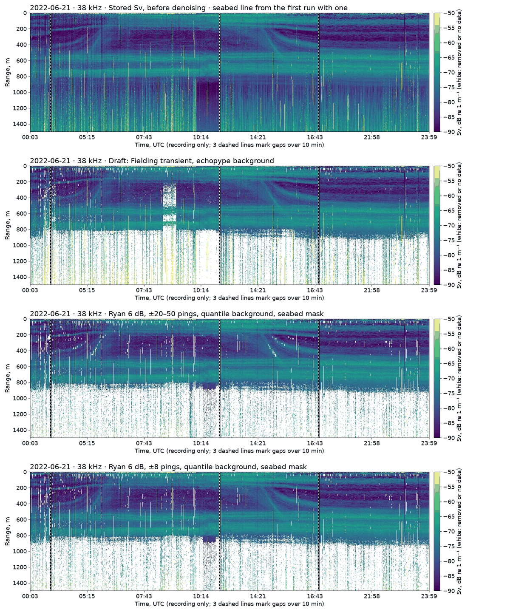
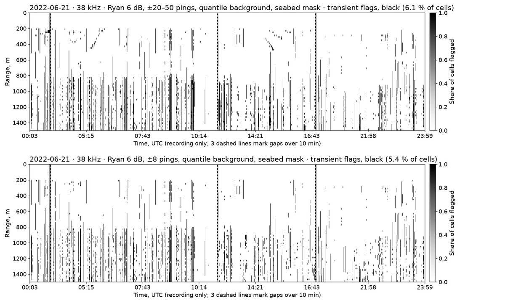
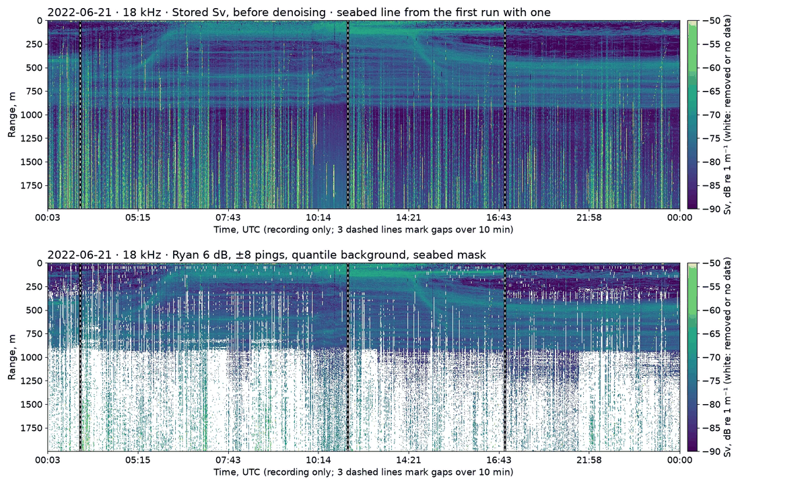
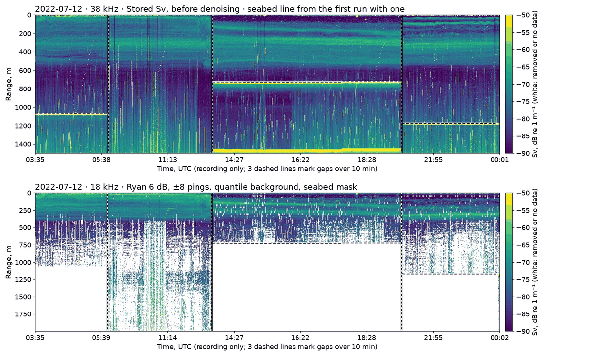
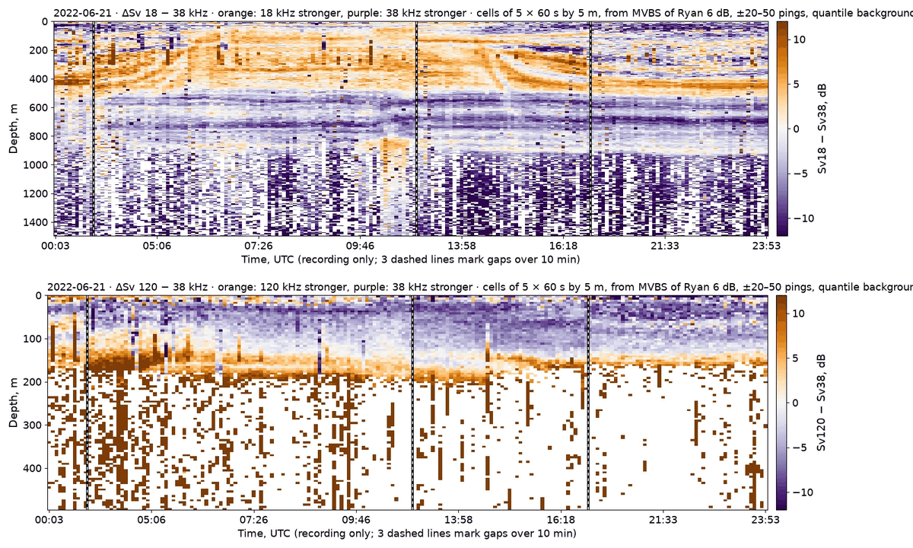

# RR2205 denoise tuning, round 5

R/V Roger Revelle cruise RR2205 (US GO-SHIP P02, Honolulu to San Diego, 13 June to 16 July 2022) carried a Simrad EK80 at 18, 38, 70, 120 and 200 kHz. Its five channels ping in turn, so each channel pings about every 39 s. Raw files are at NCEI (`s3://noaa-wcsd-pds/data/raw/Roger_Revelle/RR2205/EK80/`). Presets are tuned on five test days: 21 and 30 June, and 2, 7 and 12 July 2022. The first four are in 3,300–5,700 m of water (GEBCO). 12 July is over the California margin.

Round 5 ran three variants of Ryan et al.'s (2015) transient-noise detector, each with the experimental quantile background estimator, from the same stored Sv. Round 4 had tried the detector and the estimator separately. The presets live in `oceanstream/echodata/presets/library/` on branch `feat/denoise-presets`; [denoise-presets.md](../denoise-presets.md) describes the library.

## Findings

- **Ryan's detector and the quantile background estimator work best together.** On the four deep-water days, the combination keeps 1.8 % of the deepest 38 kHz band, against 5.4 % with the draft preset, and 0.25 % of pings are streaks, against 8.0 %. At 18 kHz the figures are 4.6 % against 11.4 %, and 1.7 % against 19.3 %. Each change alone did about half as well.
- **Long comparison blocks cut holes where layers migrate.** With 20–50 pings either side (26–66 minutes), the detector removes cells along the layers migrating at dawn and dusk (Figure 2). With 8 pings either side, or with an 8 dB margin, those layers stay intact. Both let a little more noise through: 38 kHz streak pings rise to 1.1 % and 1.3 %. **`research-vessel-open-ocean-ryan-short` (±8 pings, 6 dB) is the candidate for RR2205.**
- **18 kHz is the hard channel.** Raised-noise pings cut through its scattering layer from about 250 m down, and the detector removes 14–17 % of its cells, mostly whole pings below its 300 m start depth. Those pings are noisy inside the layer too, so removing them is defensible, but products should mark the gaps rather than read them as low backscatter.
- **The seabed is masked where it is in range.** Only 12 July has the seabed within the 38 kHz range. There the mask follows it at about 1,071 m, 727 m and 1,175 m in three recording sessions, and draws nothing between 09:29 and 12:24, when the water was deeper than the range.
- **Cross-talk pruning mistakes the seabed for cross-talk.** On 12 July it dropped every 38 and 18 kHz ping in the two sessions whose seabed lay inside its 800–1,200 m reference band. Round 5 runs with `--no-crosstalk`.
- **Frequency differencing works on interleaved data with long enough cells.** The 18−38 kHz difference shows a layer at 100–500 m that is stronger at 18 kHz, with the migration traced in it. Below about 200 m, the 120−38 kHz difference is dominated by leftover 120 kHz noise, so the classes need a signal-to-noise floor first.

## Runs compared

All runs start from the same stored Sv (`s3://oceanstream-bucket/r2r/RR2205/sv/`). Round 5 adds `--background-estimator quantile --seabed-mask --seabed-line edge --seabed-mask-offset 5 --mvbs-ping-time-bin 60s --no-crosstalk` to the pipeline.

| Run | Preset | Transient detector | Background estimator | Output container |
|---|---|---|---|---|
| Draft | `research-vessel-open-ocean` | Fielding | echopype | `denoised-research-vessel-open-ocean` |
| Draft + quantile (round 4) | `research-vessel-open-ocean` | Fielding | quantile | `denoised-research-vessel-open-ocean-quantile` |
| Ryan 6 dB, ±20–50 pings (round 4) | `research-vessel-open-ocean-ryan-tn` | Ryan, 6 dB, 20–50 pings either side | echopype | `denoised-research-vessel-open-ocean-ryan-tn` |
| Ryan 6 dB, ±20–50 pings + quantile | `research-vessel-open-ocean-ryan-tn` | as above | quantile | `denoised-research-vessel-open-ocean-ryan-tn-r5` |
| Ryan 6 dB, ±8 pings + quantile | `research-vessel-open-ocean-ryan-short` | Ryan, 6 dB, 8 pings either side | quantile | `denoised-research-vessel-open-ocean-ryan-short-r5` |
| Ryan 8 dB, ±20–50 pings + quantile | `research-vessel-open-ocean-ryan-margin` | Ryan, 8 dB, 20–50 pings either side | quantile | `denoised-research-vessel-open-ocean-ryan-margin-r5` |

Ryan's detector compares, in each depth bin below a start depth, a ping's 15th percentile of Sv with the median of that statistic over the pings either side, and flags the bin when the ping exceeds it by the margin. The quantile estimator takes the 15th percentile of block means along range as the noise level, where echopype takes the minimum, which sinks below the true level when blocks are small (`oceanstream/echodata/denoise/background_estimators.py`).

## Deep-band figures

Means of the four deep-water days, in percent, rounded to one decimal. 12 July is left out because its deep band held seabed echo until round 5 masked it, so it does not compare across rounds. Per-day figures are in each run's `sv-runs/<run>/<day>-segments.json`.

**Deep-band speckle**: share of cells in the deepest 30 % of each channel's range that survive denoising. That band holds almost no biology in this water, so lower is cleaner.

| Run | 18 kHz | 38 kHz | 70 kHz | 120 kHz | 200 kHz |
|---|---:|---:|---:|---:|---:|
| Draft | 11.4 | 5.4 | 5.7 | 1.0 | 0.6 |
| Draft + quantile (round 4) | 6.3 | 3.2 | 3.6 | 0.9 | 0.5 |
| Ryan 6 dB, ±20–50 pings (round 4) | 8.5 | 3.1 | 5.1 | 0.5 | 0.5 |
| Ryan 6 dB, ±20–50 pings + quantile | 4.6 | 1.8 | 3.4 | 0.4 | 0.4 |
| Ryan 6 dB, ±8 pings + quantile | 4.9 | 2.0 | 3.4 | 0.4 | 0.4 |
| Ryan 8 dB, ±20–50 pings + quantile | 4.8 | 2.2 | 3.5 | 0.5 | 0.4 |

**Streak pings**: share of pings keeping more than a fifth of that deep band, which show as vertical streaks.

| Run | 18 kHz | 38 kHz | 70 kHz | 120 kHz | 200 kHz |
|---|---:|---:|---:|---:|---:|
| Draft | 19.3 | 8.0 | 3.2 | 1.4 | 0.2 |
| Draft + quantile (round 4) | 11.2 | 5.1 | 2.6 | 1.1 | 0.1 |
| Ryan 6 dB, ±20–50 pings (round 4) | 8.9 | 1.6 | 0.7 | 0.2 | 0.0 |
| Ryan 6 dB, ±20–50 pings + quantile | 1.7 | 0.2 | 0.2 | 0.1 | 0.0 |
| Ryan 6 dB, ±8 pings + quantile | 4.4 | 1.1 | 0.3 | 0.1 | 0.0 |
| Ryan 8 dB, ±20–50 pings + quantile | 3.7 | 1.3 | 0.8 | 0.4 | 0.1 |

**Transient flags**: share of each channel's cells the transient detector removed. Ryan's detector also removes cells where layers move, so more is not better.

| Run | 18 kHz | 38 kHz | 70 kHz | 120 kHz | 200 kHz |
|---|---:|---:|---:|---:|---:|
| Draft | 0.2 | 0.0 | 0.1 | 0.0 | 0.0 |
| Draft + quantile (round 4) | 0.2 | 0.0 | 0.1 | 0.0 | 0.0 |
| Ryan 6 dB, ±20–50 pings (round 4) | 16.9 | 4.3 | 0.9 | 0.4 | 0.1 |
| Ryan 6 dB, ±20–50 pings + quantile | 16.9 | 4.3 | 0.9 | 0.4 | 0.1 |
| Ryan 6 dB, ±8 pings + quantile | 15.4 | 4.0 | 0.9 | 0.4 | 0.1 |
| Ryan 8 dB, ±20–50 pings + quantile | 13.7 | 2.7 | 0.7 | 0.3 | 0.1 |

## Echograms

Each panel shows one channel on its own pings, with recording gaps closed up and marked by a dashed vertical line, so the time axis is not linear. Sv runs from −90 dB (dark purple) to −50 dB (yellow). White means removed or no data.

*Figure 1. 38 kHz, 21 June. From top: stored Sv, draft, Ryan with 20–50-ping blocks, Ryan with 8-ping blocks, both with the quantile estimator. The draft leaves vertical streaks below 850 m, and its echopype background estimate removes a block of the scattering layer between about 08:30 and 09:10 (58 % of cells at 250–750 m, against 20 % with the quantile estimator). Both Ryan runs remove the streaks.*

*Figure 2. Cells removed by Ryan's detector (black) at 38 kHz on 21 June. Top: 20–50 pings either side, with diagonal traces along the layers migrating at dawn (about 05:30, 200–450 m) and dusk (about 14:40, 300–480 m). Bottom: 8 pings either side, where the diagonals are gone and only vertical noise pings remain.*

*Figure 3. 18 kHz, 21 June. Top: stored Sv, where raised-noise pings cut through the scattering layer from about 250 m down. Bottom: Ryan with 8-ping blocks and the quantile estimator. The removed noise pings leave vertical gaps below the detector's 300 m start depth.*

## Seabed masking

The pipeline's seabed stage now handles channels that ping in turn (`detect_seabed_interleaved` in `oceanstream/echodata/seabed/detection.py`). It runs the composite detector on the 38 kHz channel's own pings, down to its full 1,500 m range, and keeps only line points with a seabed echo of at least −35 dB within 10 m of them, on at least 3 of 7 neighbouring pings. It bridges gaps of up to 30 minutes whose ends agree within 25 m, as on station, and interpolates the line in time onto every ping, so all five channels are masked. The mask starts 5 m above the line, because a sloping seabed reaches the wider 18 kHz beam a few metres earlier.

On the four deep-water days the detector finds no seabed. On 12 July it masks 4.6 % of 38 kHz cells and 7.3 % of 18 kHz cells. The echo check matters. Without it, interference spikes in water deeper than the range became a line wandering between 700 and 1,500 m from 09:29 to 12:24. On station, where the seabed is real, its strongest echo was −21 dB or stronger in 90 % of pings. Where the water was deeper than the range, 90 % of pings peaked below −48 dB.

*Figure 4. 12 July. Top: 38 kHz stored Sv with the detected seabed line drawn dashed in black on white. The band at about 1,470 m in the third session is the second bottom echo, at twice the depth. Bottom: 18 kHz with Ryan (8-ping blocks), the quantile estimator and the seabed mask. Only the last 5 minutes of the day, with no detection after them to bridge to, keep a sliver of seabed echo.*

## Cross-talk pruning

The pruning step's cross-talk check compares each ping's level in an 800–1,200 m reference band with the median. On 12 July the seabed lay at 1,071 m and 1,175 m in two sessions, inside that band, and the draft run dropped all 203 pings at 38 kHz and all 201 at 18 kHz in the first, and 264 of 266 at 38 kHz and 263 of 265 at 18 kHz in the second. Until the check excludes the seabed, run with `--no-crosstalk`.

## Frequency differencing

`db_difference` (`oceanstream/echodata/multifrequency/frequency_differencing.py`) subtracts one channel's Sv from another's on a shared grid. Interleaved channels never share a ping, so the difference is taken on cells of five 60 s MVBS bins by 5 m, each of which holds pings from both channels.

*Figure 5. ΔSv on 21 June, from the MVBS of Ryan with 20–50-ping blocks and the quantile estimator. Orange means the higher frequency of the pair is stronger and purple means the lower one is; cells where either channel was removed are white. Top: 18 − 38 kHz, with a layer at 100–500 m stronger at 18 kHz, where the dawn and dusk migration is traced, and layers at 500–800 m stronger at 38 kHz. Bottom: 120 − 38 kHz, with a band at 120–200 m stronger at 120 kHz. The scattered cells below about 200 m are 120 kHz noise left near the edge of its 500 m range.*

The report job also writes a three-way split of each difference at ±2 dB. Before those classes mean anything below the top 200 m, both channels need a signal-to-noise floor.

## Other methods considered

NOAA Fisheries has described a pipeline, "Echo Classification to the Cloud", that uses HDBSCAN to find and exclude the seabed, DBSCAN to subtract background noise on the assumption that noise is acoustically more uniform than biology, and a second DBSCAN pass on multi-frequency feature vectors to classify, scored by silhouette. We did not find the paper or its code. As described, it does not fit RR2205's noise problem:

- **Noise assumption:** the steady noise floor is uniform, and the background step already removes it. What remains here is noise that is not uniform, single pings with a raised floor, which density clustering would tend to leave with the biology.
- **Silhouette score:** it measures how well clusters separate, not whether removed cells were noise.
- **Scale:** a 38 kHz day is about 11 million cells per channel, so clustering would have to run on averaged cells. Interleaving already requires cells of 60 s or more.

The second pass, unsupervised grouping of multi-frequency cells after our denoising, could replace fixed ΔSv thresholds and is worth an experimental script once the signal-to-noise floor is in.

## Next steps

1. Adopt `research-vessel-open-ocean-ryan-short` with `--background-estimator quantile` as the RR2205 candidate.
2. Add a signal-to-noise floor to frequency differencing, and make the cross-talk check exclude the seabed.
3. Take the transducer depth from platform metadata instead of the Saildrone 1.9 m offset used for the stored Sv.
4. Run the whole campaign on MareNostrum 5. Done on 2026-10-22, see [mn5-cruise-run.md](mn5-cruise-run.md).

## Reproducing

The jobs run in the EDITO namespace from `deploy/edito/ncei-sv/` (see the comments at the top of each manifest):

- `job-denoise.yaml`: stages 5–9 for the test days with one preset, with `PRESET`, `DENOISED_CONTAINER` and `PIPELINE_ARGS` set as in the table above, then per-day statistics (`split_stats.py`).
- `job-report.yaml`: echograms for every day, channel and run, and the frequency differences (`echogram_report.py`, `MODE=report`). Images go to `s3://oceanstream-bucket/r2r/RR2205/sv-runs/<run>/report/<day>/` with an `index.json`. The figures here are composites of those images.

## References

- De Robertis, A. and Higginbottom, I. (2007). A post-processing technique to estimate the signal-to-noise ratio and remove echosounder background noise. ICES Journal of Marine Science 64: 1282–1291.
- Ryan, T. E., Downie, R. A., Kloser, R. J. and Keith, G. (2015). Reducing bias due to noise and attenuation in open-ocean echo integration data. ICES Journal of Marine Science 72: 2482–2493.
