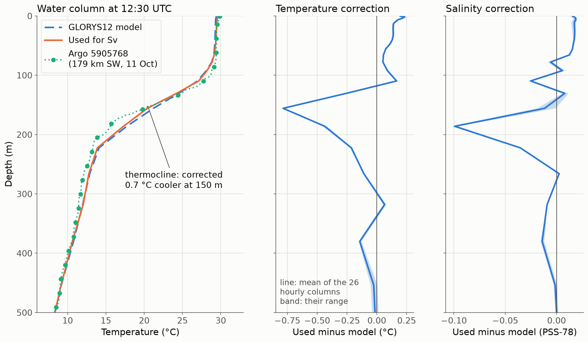
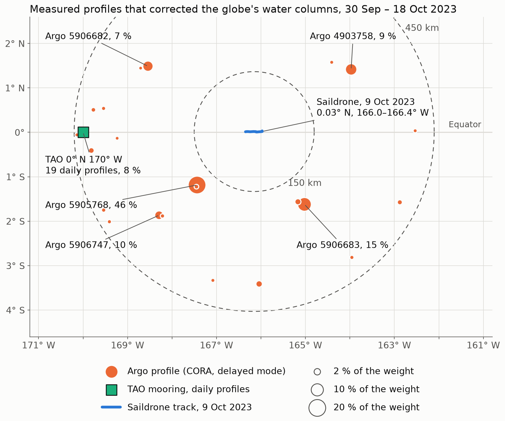

# TPOS 2023, 9 October 2023: Sv with water from the globe

22 November 2026. A worked example of `--water-from-globe`: one Saildrone day processed with temperature and salinity columns from the OceanStream globe, corrected by the Argo floats and the TAO mooring around it. It covers how to run the day yourself, what the globe sent and which measurements shaped it, what changed in Sv, and the files for a story map.

The November pilot on the same day, which fetched the globe's columns by hand and passed them with `--ctd-file`, is in [water-properties-rerun.md](water-properties-rerun.md). That page explains why water properties matter for Sv and analyses the effect echo by echo; this one is the routine way to do it.

## Summary

- One flag, `--water-from-globe`, replaces fetching casts by hand. The pipeline asks the globe for one water column per hour along the day's GPS track and corrects Sv with them sample by sample, exactly as with CTD casts.
- On 9 October 2023 the globe sent 26 hourly columns from the GLORYS12 reanalysis, each corrected with 42 to 44 measured profiles: 27 Argo profiles from 13 floats and 19 daily profiles from the TAO mooring at 0° N 170° W, between 179 and 450 km from the Saildrone and up to 9 days apart. No measurement was close enough (50 km, 12 hours) to replace a column outright.
- The measurements cooled the model's thermocline by 0.66 °C at 150 m and 0.35 °C at 200 m and warmed the mixed layer by 0.1 to 0.16 °C. At the surface the corrected column is within 0.11 °C of the Saildrone's own SBE37.
- Against the raw files' single water mass (25.55 °C, salinity 34.64, 1535.3 m/s at every depth), 38 kHz Sv rises by 1.1 to 1.5 dB at 300 to 700 m and 38 kHz NASC by 2.7 % over the long-pulse day; 200 kHz Sv rises by 0.2 to 1.0 dB in the top 150 m.
- The in-situ step itself changes little here: NASC is within 0.3 % of the pilot's model-only columns. Its value is that the water now follows the nearest measurements rather than the model alone.

## The day

| | |
|---|---|
| Platform | Saildrone SD1079, TPOS 2023 (`SD_TPOS2023_v03`) |
| Echosounder | Simrad EK80, 38 and 200 kHz |
| Position | on the equator, 0.006–0.032° N, heading west from 165.97° W to 166.35° W (52 km in the day) |
| Raw data | 24 hourly files, 3.0 GB, `s3://oceanstream-bucket/hpc/raw/SD_TPOS2023_v03/2023-10-09/` |
| Pulses | short pulse 00:00–02:00 UTC (38 and 200 kHz, 2,560 pings); long pulse 02:00–24:00 (38 kHz, 31,353 pings) |
| GPS | `s3://oceanstream-bucket/hpc/gps/SD_TPOS2023_v03/` (GeoParquet, 1 Hz) |

## Run it yourself

### What you need

- oceanstream-cli at `36ed7a8` or later (`1a86d0f` adds retries), installed with the echodata extras: `pip install -e ".[echodata]"`. The Denoise Lab and MareNostrum 5 pin echopype to `c93006b3` from OceanStream's fork (`requirements-hpc.txt`).
- A machine with about 32 GB of memory: Sv with water columns peaked at 27.5 GiB for this day in the November pilot. On EDITO, run it as a Job on the large-memory nodes or in the Denoise Lab, not in a workspace pod.
- Network access to `https://globe.oceanstream.io`. The globe keeps a copy of the tropical Pacific (120–290° E, 25° S–25° N, from November 2021), so this day needs no key. Elsewhere set `OCEANSTREAM_GLOBE_API_KEY`, which lets the globe read Copernicus Marine directly; the key is read from the environment only, never from the command line.
- Not MareNostrum 5: its machines cannot open connections to outside hosts. There, fetch the columns on EDITO and pass them with `--ctd-file` (the pilot's route).

### 1. Get the inputs

```bash
export AWS_ENDPOINT_URL=https://s3.waw3-1.cloudferro.com
aws s3 sync s3://oceanstream-bucket/hpc/raw/SD_TPOS2023_v03/2023-10-09/ data/raw/2023-10-09/
aws s3 sync s3://oceanstream-bucket/hpc/gps/SD_TPOS2023_v03/ data/gps/
aws s3 cp s3://oceanstream-bucket/edito-tests/SD_TPOS2023_v03/preset/tpos-sd-2023.toml data/
```

The preset file is the Denoise Lab's `tpos-sd-2023` as it ran (hash 91b61fd3). The library preset of the same name in `oceanstream/echodata/presets/library/` is an older, shorter version (200 kHz SNR threshold 6 dB instead of 3 dB, fewer frequencies), so use the lab's file to reproduce the lab's products. The lab's service API returns the current TOML with `POST /run-spec` (see the Denoise Lab's `docs/agents.md`).

### 2. Run the day

```bash
python scripts/batch_processing/process_from_raw.py \
    --cruise-id SD_TPOS2023_v03 --start-date 2023-10-09 --end-date 2023-10-09 \
    --expected-categories short_pulse,long_pulse \
    --raw-source local --raw-dir data/raw/2023-10-09 \
    --gps-dir data/gps \
    --water-from-globe \
    --denoise-config data/tpos-sd-2023.toml --preset-key tpos-sd-2023 \
    --local-save out --output-container tpos-2023-10-09 \
    --n-workers 1 --memory-limit 24GB --threads-per-worker 8 \
    --surface-exclusion-depth 1.9 --sv-clip-max-db -10 --prune-artefact-threshold 0.5 \
    --mvbs-range-bin 1m --mvbs-ping-time-bin 10s --nasc-range-bin 10m --nasc-dist-bin 0.5nmi \
    --save-mvbs-netcdf --save-nasc-netcdf \
    --skip-pmtiles --skip-campaign-echograms --no-crosstalk
```

The flags from `--surface-exclusion-depth` on are the lab's run specification for this survey, so the products match the lab's. To write to S3 instead of a local folder, replace `--local-save out` with `--storage-backend s3 --s3-bucket <bucket> --s3-prefix <prefix> --s3-endpoint-url https://s3.waw3-1.cloudferro.com --s3-region waw3-1`. Runs submitted with `oceanstream hpc` execute on MareNostrum 5 and cannot use the option.

### The globe options

| Option | What it does |
|---|---|
| `--water-from-globe` | Water columns from the globe along the day's GPS track. Excludes `--ctd-file` and `--env-params-file`. |
| `--globe-model auto` | The default: the GLORYS12 reanalysis (`GLOBAL_MULTIYEAR_PHY_001_030`) when the globe's `/api/env/sources` says it covers the day (1993-01-01 to 2026-10-06 today), else the analysis and forecast (`anfc`, from 2022-06-01). `glorys` or `anfc` forces one. |
| `--globe-no-insitu` | Model columns only, without the measured profiles. |
| `--globe-url URL` | Another globe; the default is `$OCEANSTREAM_GLOBE_URL`, else `https://globe.oceanstream.io`. |

### What the pipeline does

1. Before Sv, for each pulse category, it takes the GPS fixes from an hour before the first ping to an hour after the last (the survey's GPS source, or the raw files' own NMEA fixes when there is none), drops failed (0, 0) fixes and averages them per UTC hour, longitude as a direction so that a track across 180° stays put. Each mean is timed at the middle of its hour.
2. With `auto` it asks `/api/env/sources` which model covers the day, then sends the hourly positions to `POST /api/env/track?format=cchdo` with `"insitu": {}`. The globe answers with a netCDF file in the layout of CCHDO's CTD files, one column per position on the model's 38 levels to 1452 m. A refused request (rate limit, a failing replica, a restart) is tried up to six times.
3. The file is saved as `<EchoData>--globe-casts.nc` next to the combined EchoData and read by the same code as `--ctd-file` (`oceanstream.echodata.environment.ctd_casts`). echopype gets each channel's harmonic-mean sound speed and path-mean absorption per ping (Mackenzie 1981 and Francois–Garrison 1982, pH 8). Every sample is then corrected for the absorption along its own path, and that loss is stored as `absorption_loss` so that noise estimation and the integration noise limit use the same values.
4. The Sv store's `environment` attribute records the globe, the product and the kinds of column.

The log shows it:

```
Water from the globe (https://globe.oceanstream.io, glorys): 4 model corrected by nearby profiles
CTD: 4 casts from …/2023-10-09--short_pulse--combined--globe-casts.nc, 2023-10-08T23:30 to 2023-10-09T02:30
Water from the globe (https://globe.oceanstream.io, glorys): 24 model corrected by nearby profiles
CTD: 24 casts from …/2023-10-09--long_pulse--combined--globe-casts.nc, 2023-10-09T01:30 to 2023-10-10T00:30
```

### Check the result

```python
import xarray as xr
sv = xr.open_zarr("out/tpos-2023-10-09/2023-10-09/2023-10-09--long_pulse.zarr")
print(sv.attrs["environment"])
print(sv["absorption_loss"].dims)       # ('channel', 'ping_time', 'range_sample')
```

On this day the attribute reads: "Sound speed and absorption from 24 water columns along the track from the OceanStream globe (https://globe.oceanstream.io/api/env/track, CMEMS GLOBAL_MULTIYEAR_PHY_001_030 (cmems_mod_glo_phy_my_0.083deg_P1D-m); in-situ profiles from the globe's store (Argo, CTD, XBT, gliders, TAO); 24 model corrected by nearby profiles); Mackenzie (1981) sound speed and Francois-Garrison (1982) absorption, pH 8.0".

### In the Denoise Lab

The same thing is a survey setting. In the survey's water settings, tick "Take the days not listed above from the OceanStream globe, along the GPS track", leave the model on automatic and the in-situ corrections on. A run must recompute Sv (`skip_sv` off) for the setting to apply. Values entered for a specific day still take precedence. The lab's run of this day is `24254911`, 22 November 2026, worker on oceanstream-cli `1a86d0f`: 15 minutes in all, of which the globe step took under 30 seconds.

## What the globe sent

### The model columns

26 hourly columns: 4 for the short pulse (23:30 on 8 October to 02:30) and 24 for the long pulse (01:30 to 00:30 on 10 October), each the GLORYS12 daily mean in its 1/12° cell (0.0° N, 166.0° W to 166.33° W). The columns barely change through the day; the one at 12:30 UTC (0.017° N, 166.153° W):

| Depth | Model temperature | Used for Sv | Correction | Salinity correction |
|---|---|---|---|---|
| 10 m | 29.32 °C | 29.48 °C | +0.16 °C | +0.017 |
| 50 m | 29.21 °C | 29.31 °C | +0.10 °C | +0.016 |
| 100 m | 27.60 °C | 27.73 °C | +0.13 °C | −0.008 |
| 150 m | 21.96 °C | 21.30 °C | −0.66 °C | −0.007 |
| 200 m | 16.34 °C | 15.99 °C | −0.35 °C | −0.075 |
| 300 m | 12.28 °C | 12.29 °C | +0.01 °C | −0.005 |
| 500 m | 8.35 °C | 8.33 °C | −0.01 °C | 0.000 |
| 1000 m | 4.46 °C | 4.47 °C | +0.01 °C | −0.003 |

The correction differs by at most 0.05 °C between columns at any depth, because the same profiles weigh on all of them in nearly the same proportions. The Saildrone's SBE37 at 0.5 m read 29.53 °C on average that day (29.36–29.88 °C, 44 half-hourly values, salinity 35.42): the model's top level was 29.44 °C and the corrected one 29.64 °C.



### How the globe chooses and weighs the measurements

The rules are the globe's defaults (arco-3d `server/env/insitu_casts.py`, `InsituOptions`):

- **Which profiles:** temperature profiles from Argo floats, CTDs, XBTs, gliders and moorings that reach at least 50 m, with quality flags good or probably good, within 450 km and 9 days of a column.
- **Replacing:** a profile within 50 km and 12 hours replaces the column over the depths it measured. None came that close on this day.
- **Correcting:** otherwise each profile's difference from the model at its own position and day is weighted by exp(−½[(d / 150 km)² + (t / 3 days)²]) and the column is shifted by Σ w·Δ / (Σ w + 0.5). The 0.5 shrinks the correction where few or distant profiles are available. Below a profile's deepest level the shift fades to zero over 100 m.

Each column was corrected with 42 to 44 of the 46 profiles in reach. Their weights sum to 1.4 to 2.0 per column, so the shrink keeps three quarters to four fifths of the weighted mean difference.

### The measurements

46 profiles from 14 platforms, 30 September to 18 October 2023:

| Platform | Type | Mean position | Profiles | Dates | Closest to the track | Share of the weight |
|---|---|---|---|---|---|---|
| Argo 5905768 | float | 1.20° S, 167.44° W | 4 | 1 and 11 Oct | 179 km | 45.9 % |
| Argo 5906683 | float | 1.59° S, 165.10° W | 2 | 2 and 12 Oct | 198 km | 14.7 % |
| Argo 5906747 | float | 1.87° S, 168.25° W | 4 | 1 and 12 Oct | 295 km | 9.6 % |
| Argo 4903758 | float | 1.50° N, 164.19° W | 2 | 30 Sep and 10 Oct | 245 km | 8.8 % |
| TAO 0° N 170° W | mooring | 0.00° N, 170.00° W | 19 | 30 Sep to 18 Oct, daily | 405 km | 7.6 % |
| Argo 5906682 | float | 1.47° N, 168.62° W | 2 | 9 and 18 Oct | 293 km | 6.8 % |
| Argo 5906698 | float | 3.37° S, 166.56° W | 2 | 7 and 17 Oct | 380 km | 2.1 % |
| Argo 4903189 | float | 0.27° S, 169.52° W | 2 | 8 and 18 Oct | 320 km | 1.3 % |
| Argo 5906696 | float | 1.58° S, 162.88° W | 1 | 5 Oct | 387 km | 0.8 % |
| Argo 5906675 | float | 0.27° N, 169.75° W | 2 | 6 and 16 Oct | 359 km | 0.8 % |
| Argo 4903742 | float | 0.22° N, 169.95° W | 2 | 3 and 13 Oct | 383 km | 0.6 % |
| Argo 5905669 | float | 1.88° S, 169.47° W | 2 | 4 and 14 Oct | 404 km | 0.5 % |
| Argo 6902920 | float | 2.82° S, 163.96° W | 1 | 16 Oct | 387 km | 0.2 % |
| Argo 3902370 | float | 0.04° N, 162.53° W | 1 | 2 Oct | 382 km | 0.1 % |

The Argo profiles come from CORA, Copernicus Marine's delayed-mode in-situ product; the mooring's daily means from NOAA PMEL's TAO array, down to 500 m. "Share of the weight" is each platform's part of all the weights summed over the 26 columns. The exact position, time and measured values of every profile are in the story-map files below.



Two things stand out:

- **One float carries almost half the weight.** Argo 5905768 surfaced 179 km south-west of the Saildrone about a day after it passed, the nearest of all the profiles (Argo 5906682 surfaced on the day itself, but 293 km away). Each of its ascents appears twice in CORA, 17 minutes apart with 403 and 762 levels, and the globe counts the two records as two profiles, which doubles the float's say. Its salinity is flagged bad (QC 4) in both, so it corrects temperature only.
- **The mooring is far but steady.** TAO 0° N 170° W is 405 km to the west, near the edge of the reach, but it gives a profile every day, and together its 19 days carry 7.6 % of the weight.

The cooler thermocline is what most nearby floats measured: at 150 m the Argo profiles sit between 2.9 °C cooler and 1.0 °C warmer than the model, and 24 of the 27 are cooler.

### Checking the rebuild

The globe does not list the profiles behind each column, so the tables and map files here were rebuilt from its public endpoints (`/api/insitu/observations`, `/api/env/track`) with the same selection and weights. The rebuild finds the same number of profiles for each of the 26 columns as the casts file records (`correction_casts`), and reproduces the globe's corrections within 0.02 °C at every depth. The small remainder is because the rebuild compares in-situ temperature where the globe uses potential temperature. The scripts are in `s3://oceanstream-bucket/hpc/env/SD_TPOS2023_v03/globe-2023-10-09/scripts/`.

## What it changed in Sv

Against the lab's products from the raw files' water values (one water mass at 25.55 °C, salinity 34.64, 1535.3 m/s at every depth). MVBS is the day mean of denoised Sv; both sets were denoised with the same preset, each over its own Sv.

| Depth | 38 kHz long pulse | 38 kHz short pulse | 200 kHz |
|---|---|---|---|
| 2–25 m | −0.23 dB | +0.05 dB | +0.21 dB |
| 25–50 m | −0.13 dB | −0.27 dB | +0.23 dB |
| 50–100 m | −0.18 dB | −0.26 dB | +0.63 dB |
| 100–150 m | −0.27 dB | 0.00 dB | +0.97 dB |
| 150–200 m | −0.26 dB | −0.25 dB | +0.59 dB |
| 200–250 m | +0.10 dB | +0.06 dB | |
| 250–300 m | +0.51 dB | +0.67 dB | |
| 300–400 m | +1.39 dB | +2.23 dB | |
| 400–500 m | +1.11 dB | +1.52 dB | |
| 500–700 m | +1.46 dB | +1.25 dB | |
| 700–1000 m | +2.65 dB | +2.38 dB | |
| 1000–1400 m | +4.91 dB | +5.04 dB | |

NASC, mean per 0.5 nmi (m²/nmi²):

| | Raw-file values | Globe, in-situ corrected | Change | Pilot, model only |
|---|---|---|---|---|
| 38 kHz long pulse | 10,215 | 10,495 | +2.7 % | 10,492 |
| 38 kHz short pulse | 2,375 | 3,084 | +29.8 % | 3,074 |
| 200 kHz | 472 | 504 | +6.8 % | 503 |

At 38 kHz the cold water below the thermocline absorbs more than the warm surface water the files assumed, so deep echoes had been under-compensated; most of the short pulse's NASC sits in the 400 to 700 m scattering layer, hence its larger change. At 200 kHz the real surface water is warmer than 25.55 °C and absorbs more, which raises Sv in the top 150 m. The pilot page shows the same effect for each echo, separately from the denoising.

## Data for a story map

In [storymap/](storymap/), also at `s3://oceanstream-bucket/hpc/env/SD_TPOS2023_v03/globe-2023-10-09/storymap/`. Coordinates are WGS84 longitude and latitude, temperatures in-situ °C, salinity PSS-78, depths in metres.

| File | Holds |
|---|---|
| `track-and-water-columns.geojson` | The Saildrone's track on 9 October as a line of 1-minute GPS means, and the 26 hourly water columns as points at the hourly mean positions: `time_utc`, the model's grid cell, `correction_profiles`, `temperature_<d>m_model` and `temperature_<d>m_used`, and `salinity_correction_<d>m` for d = 10, 50, 100, 150, 200, 300, 500 and 1000 m |
| `insitu-profiles.geojson` | The 46 profiles as points: `platform_id`, `wmo`, `platform_type`, `source`, `time_utc`, `deepest_m`, `has_salinity`, `closest_km`, `hours_from_track` (profile time minus the time of the nearest hourly position), `columns_weighed`, `weight_max`, `weight_share_pct`, `T<d>` (measured temperature), `dT<d>` (measured minus model) and `links` to the float or mooring pages. Also two circles, 150 km (the correction's length scale) and 450 km (the reach), around the 12:30 position |
| `platforms.csv` | One row per platform, as in the table above |
| `profiles.csv`, `columns.csv` | The same properties as plain tables |

Alongside them in S3: the globe's casts files as the run used them (`casts-short_pulse.nc`, `casts-long_pulse.nc`), every in-situ observation the globe read for this day (`insitu-observations.parquet`, 47,260 rows), and the Saildrone's SBE37 values for the day (`sd1079-sbe37-2023-10-09.csv`).

A possible sequence of scenes:

1. A Saildrone on the equator at 166° W, 9 October 2023, listening at 38 and 200 kHz down to 1400 m.
2. The ocean model's view of the water beneath it: a 29 °C surface layer, a sharp thermocline near 150 m, 8 °C at 500 m.
3. The floats and the mooring within 450 km and 9 days, and how much each counts.
4. The corrected column: a cooler thermocline, a slightly warmer surface that matches the Saildrone's own sensor.
5. What it does to the echoes: the deep scattering layer at 400 to 700 m 1.1 to 1.5 dB stronger.

## Limits

- **Range uses one sound speed per ping.** Absorption is corrected for each sample, but travel time is turned into range with one harmonic-mean sound speed per ping and channel, over the channel's whole range: 1497 m/s for 38 kHz down to 1400 m. The upper few hundred metres therefore sit 2 to 3 % shallow, about 3 m at 100 m. This comes from the CTD-cast code and is the same with `--ctd-file`.
- **Daily-mean model, hourly positions.** The columns follow the Saildrone hour by hour, but the model is a daily mean, so the mixed layer's day–night cycle is not in them.
- **Duplicate records.** Floats whose ascents appear twice in CORA count twice. On this day that doubles the weight of Argo 5905768 and 5906747.
- **Coverage.** GLORYS12 currently ends on 2026-10-06; later days use the analysis and forecast. Outside the globe's tropical-Pacific copy a key is needed, and on MareNostrum 5 the globe cannot be reached at all.

## Where things are

| What | Where |
|---|---|
| The option | oceanstream-cli `36ed7a8` (`--water-from-globe`), `1a86d0f` (retries); `oceanstream/echodata/environment/globe.py` |
| Lab support | denoise-lab-webapp `0ef3f3b` (survey setting, per-sample absorption in echograms and Studio), deployed as `sha-1edc389` |
| The globe's in-situ step | arco-3d `ced8536`, `server/env/insitu_casts.py` |
| Lab run | `24254911`; Sv in `s3://oceanstream-bucket/denoise-lab/denoise-lab-sv/2023-10-09/`, products in `s3://oceanstream-bucket/denoise-lab/denoise-lab-tpos-sd-2023/2023-10-09/` |
| Products before the change | `s3://oceanstream-bucket/hpc/compare/lab-2023-10-09-before-globe-20261122/` |
| Casts, in-situ observations, scripts | `s3://oceanstream-bucket/hpc/env/SD_TPOS2023_v03/globe-2023-10-09/` |
| Preset as run | `s3://oceanstream-bucket/edito-tests/SD_TPOS2023_v03/preset/tpos-sd-2023.toml` |
