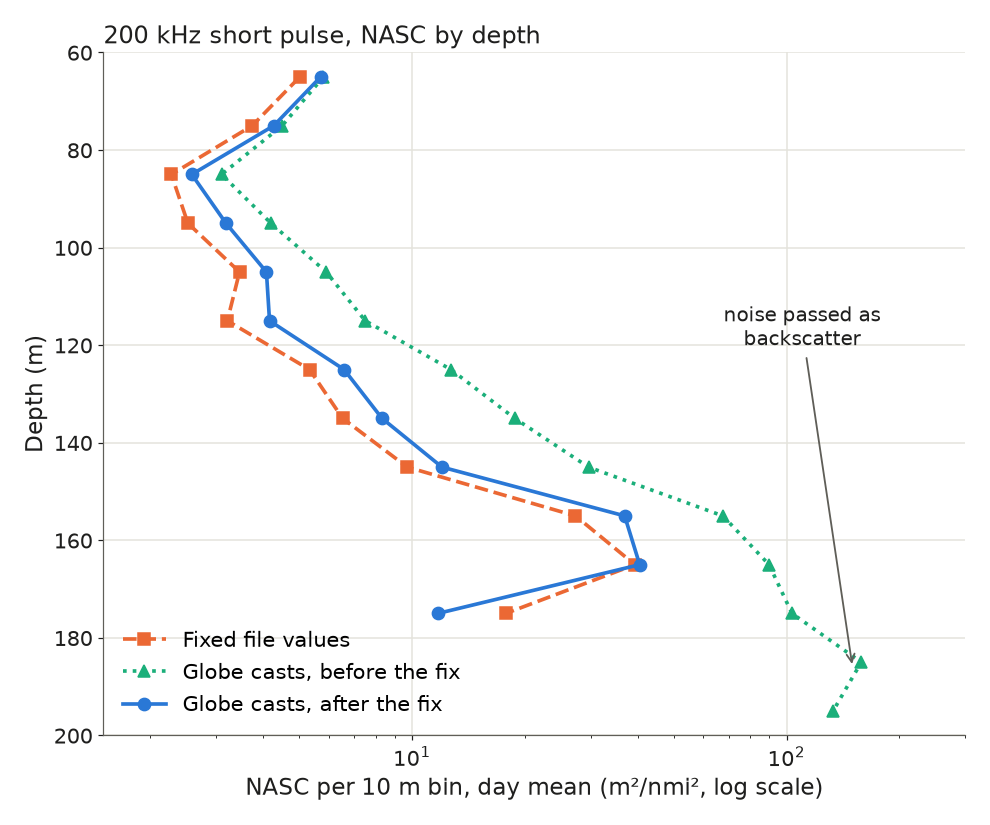
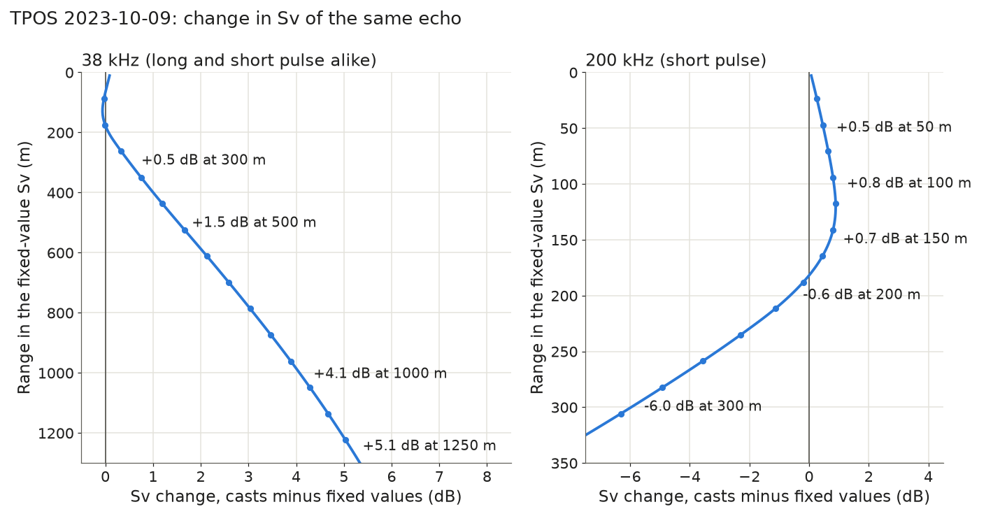
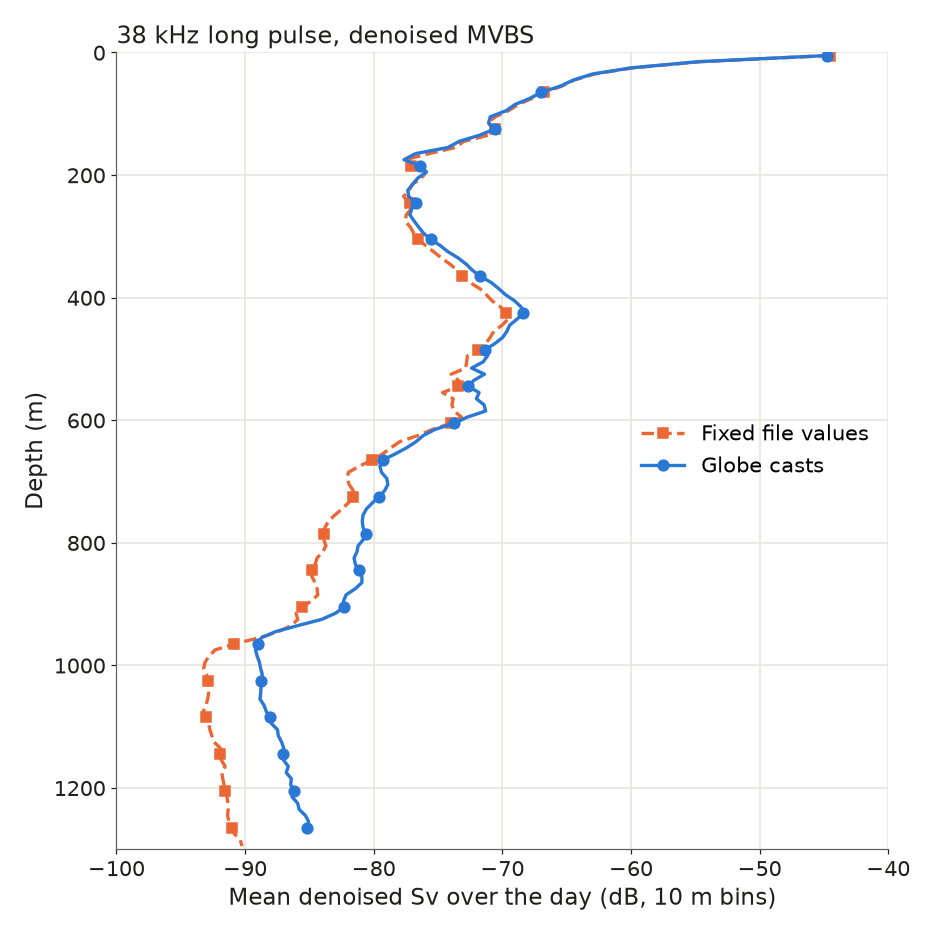

# TPOS 2023: Sv with water properties from the globe

20 November 2026. Saildrone TPOS 2023 (`SD_TPOS2023_v03`), EK80 at 38 and 200 kHz, 141 days with echosounder data from 31 May to 5 November 2023.

Since 22 November 2026 the pipeline fetches the same columns itself with `--water-from-globe`, corrected by nearby measured profiles: [water-from-globe-2023-10-09.md](water-from-globe-2023-10-09.md) repeats this day that way.

## Summary

- Every published TPOS Sv used one fixed set of water values from the raw files: 25.55 °C, salinity 34.64 and 1535.3 m/s, on all days and at all depths. The real column at the equator has a 29 °C surface layer, a thermocline near 150 m and 8 °C water at 500 m.
- The oceanstream globe now serves model temperature and salinity columns (GLORYS12) as casts the pipeline reads with `--ctd-file`. One request returned 3,384 hourly casts along the whole track in 22 seconds.
- A pilot on 2023-10-09 compared Sv with the casts against Sv with the fixed values: same code, same Denoise Lab preset `tpos-sd-2023`, same flags. At 38 kHz the same echo is unchanged above 200 m, 1.5 dB stronger at 500 m and 4.1 dB stronger at 1000 m, and every echo sits 2.5% shallower. At 200 kHz echoes in the top 150 m gain up to 0.8 dB.
- The first pilot exposed a fault in the CLI: with casts, the noise estimators still rebuilt the gain from one absorption value per ping, so 200 kHz noise passed the background filter as backscatter. oceanstream-cli `bc334fa` fixes it, and a second pilot confirmed the fix.
- The whole campaign is being reprocessed on EDITO in place, into `hpc/products/SD_TPOS2023_v03/`, with Andrei's agreement.
- Only one other campaign, RR2205, was processed with casts, so it is the only other run hit by the fault. Several other campaigns have the same kind of water-value error as TPOS; two of them (HB2401 and HB2304) have file temperatures of 28 °C in cold water, which biases their 120 and 200 kHz Sv by several dB within 100 m.

## Water-column casts from the globe

The globe's water-column service (arco-3d `server/env/`, `POST /api/env/track`) turns positions into model columns and returns them in the CCHDO CTD layout that `--ctd-file` reads.

- Positions: hourly means of the GPS track `s3://oceanstream-bucket/hpc/gps/SD_TPOS2023_v03/`, 3,384 hours. 2023-07-10 has no usable fix (the receiver reported about 0° N 0° E all day) and two fixes on 2023-10-12 are corrupt; those were left out and the hours of 2023-07-10 interpolated between the neighbouring days.
- Model: GLORYS12 reanalysis (`GLOBAL_MULTIYEAR_PHY_001_030`), daily, 1/12°, 38 levels to 1452 m, read from the globe's tropical-Pacific mirror. The globe's default order tries the analysis-and-forecast model first, but its mirror holds GLORYS12 for 2023 and reading Copernicus Marine directly is switched off on the deployed globe, so the request names `glorys`. The globe's own validation on this survey (arco-3d `docs/model-profiles.md`) found GLORYS12 a little warm in the thermocline (+0.5 to +0.9 °C at 100–200 m), which moves 38 kHz Sv by 0.05 dB RMS and 200 kHz by 0.4 dB RMS over 200 m; on 2023-10-09 it was the closer of the two models.
- The casts, the hourly track and the request are in `s3://oceanstream-bucket/hpc/env/SD_TPOS2023_v03/`.

The pipeline takes each channel's sound speed (Mackenzie) and absorption (Francois–Garrison, pH 8) from the casts either side of each ping, and corrects every sample for the absorption along its own path rather than one value for the channel.

## How the pilot was run

Two EDITO Jobs on large-memory nodes, without a GPU request, for 2023-10-09:

| | Casts | Fixed values (control) |
|---|---|---|
| Sv | `--ctd-file` with the globe casts | the raw files' values |
| Denoising | lab preset `tpos-sd-2023` (TOML from the lab's service API, hash 91b61fd3) | the same |
| Flags | the lab's run spec for the survey | the same |
| Output | `s3://oceanstream-bucket/edito-tests/SD_TPOS2023_v03/` | `s3://oceanstream-bucket/edito-tests/SD_TPOS2023_v03-fixedenv/` |

The control reproduces the lab's own run of the day (b36f9b2a) exactly: NASC 10,214.9 (38 kHz long pulse), 2,374.7 (38 kHz short) and 471.6 m²/nmi² (200 kHz), the same as the lab's. Every difference below is therefore the water properties alone.

## The noise-model fault and its fix

With `--ctd-file`, the Sv of each sample is corrected for the absorption integrated along its path, 2 [A(d + r) − A(d)], but the Sv store kept only the channel's single path-mean `sound_absorption` per ping. Everything that estimates or subtracts background noise rebuilt the gain as 2 × `sound_absorption` × range: the echopype-style estimator, the quantile estimator and the −65 dB integration noise limit.

On 2023-10-09 the 200 kHz absorption is 92 dB/km in the warm surface water and 74 dB/km on average over the 347 m range. The noise curve therefore sat 3.4 dB too low at 100 m and 4.6 dB too low at 150–200 m, and with the preset's 3 dB SNR threshold noise passed as backscatter: NASC at 100–200 m went from 113 to 627 m²/nmi², the same in every distance bin, and integration ended at 200 m instead of 180 m. At 38 kHz the error was smaller and the other way, up to 0.85 dB too high at 200–300 m, which removed slightly too much.

The fix (oceanstream-cli `bc334fa`): Sv computed with casts stores `absorption_loss`, the loss in dB that each sample was compensated for, with the same dimensions as Sv. It is averaged like `echo_range` when Sv is binned in range. `products._range_terms` uses it when present, which covers both background estimators and the integration noise limit. Stores without casts are unchanged. Four new tests cover it.

## Sv changes on 2023-10-09

### Water values used

| | Fixed values from the raw files | Globe casts |
|---|---|---|
| Sound speed, 38 kHz | 1535.3 m/s | 1497.1 m/s (harmonic mean, 0–1268 m) |
| Sound speed, 200 kHz | 1535.3 m/s | 1522.8 m/s (harmonic mean, 0–347 m) |
| Absorption, 38 kHz | 6.65 dB/km at all depths | 6.0 dB/km near the surface, 8.88 dB/km mean over the range |
| Absorption, 200 kHz | 86.3 dB/km at all depths | 91.8 dB/km near the surface, 73.8 dB/km mean over the range |

### Sv of the same echo

Each echo compared at the same sample in both stores, median over the day's pings. The 38 kHz numbers are identical for the short and the long pulse.

| Range, fixed → casts | 38 kHz | 200 kHz |
|---|---|---|
| 10 → 9.8 m | +0.09 dB | +0.14 dB |
| 50 → 48.8 m | +0.03 dB | +0.48 dB |
| 100 → 97.5 m | −0.04 dB | +0.83 dB |
| 150 → 146.3 m | −0.04 dB | +0.70 dB |
| 200 → 195.0 m | +0.07 dB | −0.63 dB |
| 300 → 292.5 m | +0.51 dB | −5.96 dB (noise only) |
| 400 → 390.0 m | +1.01 dB | |
| 500 → 487.5 m | +1.53 dB | |
| 600 → 585.0 m | +2.07 dB | |
| 700 → 682.7 m | +2.60 dB | |
| 800 → 780.2 m | +3.11 dB | |
| 1000 → 975.2 m | +4.07 dB | |
| 1250 → 1219.0 m | +5.14 dB | |

The deepest 38 kHz sample moves from 1300 m to 1268 m, because the column's mean sound speed is 2.5% lower than the files assumed. At 38 kHz the warm surface water absorbs less than the cold water below, so the files' single value was close near the surface and too low at depth. At 200 kHz it is the other way round: the 29 °C surface water absorbs more than the files' 25.55 °C value.

### Denoised Sv by depth (MVBS, day mean)

| Layer | 38 kHz long pulse | 38 kHz short pulse | 200 kHz |
|---|---|---|---|
| 6–50 m | −0.23 dB | −0.06 dB | +0.22 dB |
| 50–100 m | −0.18 dB | −0.25 dB | +0.61 dB |
| 100–150 m | −0.26 dB | +0.01 dB | +0.96 dB |
| 150–200 m | −0.26 dB | −0.25 dB | +0.65 dB |
| 200–300 m | +0.29 dB | +0.36 dB | |
| 300–400 m | +1.36 dB | +2.22 dB | |
| 400–500 m | +1.09 dB | +1.52 dB | |
| 500–700 m | +1.44 dB | +1.23 dB | |
| 700–1000 m | +2.63 dB | +2.36 dB | |
| 1000–1300 m | +4.89 dB | +5.04 dB | |

Layer means mix the Sv gain with the depth shift: a scattering layer moves 2.5% shallower, so a layer's upper edge can move into the bin above.

### NASC by layer

Mean per 0.5 nmi, m²/nmi².

| Layer | 38 kHz long, fixed → casts | 38 kHz short, fixed → casts | 200 kHz, fixed → casts |
|---|---|---|---|
| 0–10 m | 6,168 → 6,333 (+3%) | 66 → 72 (+10%) | 17 → 19 (+12%) |
| 10–100 m | 2,888 → 2,691 (−7%) | 490 → 478 (−2%) | 342 → 360 (+5%) |
| 100–150 m | 172 → 162 (−6%) | 68 → 68 (0%) | 28 → 35 (+25%) |
| 150–200 m | 60 → 56 (−6%) | 35 → 33 (−6%) | 85 → 89 (+6%) |
| 200–300 m | 87 → 93 (+7%) | 32 → 35 (+8%) | |
| 300–400 m | 188 → 255 (+36%) | 135 → 226 (+67%) | |
| 400–500 m | 347 → 444 (+28%) | 720 → 1,019 (+41%) | |
| 500–700 m | 251 → 352 (+40%) | 761 → 1,016 (+33%) | |
| 700–1000 m | 45 → 82 (+84%) | 59 → 102 (+72%) | |
| 1000–1300 m | 8 → 23 (+178%) | 9 → 25 (+185%) | |
| Whole column | 10,215 → 10,492 (+3%) | 2,375 → 3,074 (+29%) | 472 → 503 (+7%) |

The small losses in the upper 200 m at 38 kHz come from the depth compression (thinner layers, echoes moving into the 0–10 m bin), not from a change in Sv. At 200 kHz the last bin with NASC moves from 180 m to 170 m.

## Cost and the full run

| | Sv | Denoising, MVBS, NASC, echograms |
|---|---|---|
| Time per day | 8.3 min | 10.9 min |
| Peak memory | 27.5 GiB (17.8 GiB before the fix) | 15.3 GiB |

Storing the absorption loss adds about 0.13 GB per day to the Sv stores (0.06 GB short pulse, 0.05 GB long pulse), about 18 GB over the campaign.

The full run started on 20 November 2026 at about 15:30 UTC: four Jobs of 35–36 days each, Sv then denoising for each day before the next, written in place into `s3://oceanstream-bucket/hpc/products/SD_TPOS2023_v03/<day>/`. A first start at 15:05 UTC failed at denoising on its first day in every Job: with Sv and denoised products in the same folder, the pipeline refuses an explicit `--sv-source-container` naming that folder. By then the new Sv had replaced v03's for 2023-05-31, 07-22, 08-27 and 10-01 under their old denoised products. The Jobs were stopped, `run.sh` no longer passes the flag in that case (oceanstream-hpc-runs `d9bdee3`), each Job now stops at the first failed denoising, and the restart began with those four days. The file names match the published v03 products one for one; the run adds a denoising statistics file per pulse category and a JSON sidecar per echogram. The STAC Items are rewritten after the run. The run covers 141 days: 2023-05-30 is left out (below), and 2023-06-03 is new, because after the raw files were renamed by first ping (6 November) one file whose first ping is after midnight now forms that day. The v03 products are overwritten and were not copied first; the shape of every v03 Sv store was recorded before the run (`~/work/hpc-runs/SD_TPOS2023_v03/v03-sv-shapes.json`) so that days with fewer pings can be found afterwards.

2023-05-30, the deployment day, has no echosounder data: its 98 non-empty files are all in passive mode (`channel_mode` 1). Their Sv rises steadily from −155 dB at 1 m to −83 dB at 1300 m, which is noise with gain applied and no transmit pulse. The pipeline has left passive channels out since oceanstream-cli `5b16277` (written for Falkor (too)), so the day is left out of the run and its v03 products, which are that noise processed as Sv, stay in place. 2023-05-31 also starts with passive files (28 of them are left out), so its long-pulse Sv now holds about 17,100 pings instead of v03's 27,022.

## Other campaigns

### The noise-model fault

Only Sv computed with `--ctd-file` is affected. Of the published campaigns only RR2205 was processed that way, so it is the only one to redo for this reason. Its Sv stores have no `absorption_loss`, so it needs either Sv again from raw and then denoising (32 days), or a small backfill that computes `absorption_loss` from its CTD file and the stored ranges and then denoising only.

### Water values in the raw files

Every other campaign used the water values set in its raw files. The error that leaves in Sv grows with range: about 2 × (absorption used − true absorption) × range, plus a range shift from the sound speed. The size depends on frequency and on how far the file values are from the water:

| Temperature | 18 kHz | 38 kHz | 70 kHz | 120 kHz | 200 kHz |
|---|---|---|---|---|---|
| 2 °C | 3.4 | 10.7 | 19.7 | 28.5 | 41.9 |
| 8 °C | 2.9 | 10.4 | 22.9 | 36.0 | 50.3 |
| 15 °C | 2.3 | 9.1 | 23.8 | 44.2 | 65.2 |
| 20 °C | 2.0 | 7.9 | 22.6 | 47.3 | 76.6 |
| 28 °C | 1.6 | 6.2 | 19.0 | 46.2 | 89.2 |

Francois–Garrison absorption in dB/km at 50 m, salinity 35, pH 8.

Values in the published products (one day per campaign):

| Campaign | Area, dates | Range kept | File values | Concern |
|---|---|---|---|---|
| HB2401 | NE US shelf, Feb 2024 | 500 m | 28.0 °C, 35.9 (200 kHz absorption 94 dB/km) | February water is about 5–10 °C. If 8 °C: 120 kHz +2.6 dB and 200 kHz +8.6 dB too high at 100 m, 38 kHz −0.7 dB |
| HB2304 | NE US shelf, Sep–Nov 2023 | 500 m | 28.0 °C, 35.9 | Autumn water is colder than 28 °C, so the same sign as HB2401, smaller |
| HB2202, HB2204, HB2301, HB2302, HB2402, HB2403, HB2405, HB2407, HB1507 | NE US shelf and slope | 500 m | 6–18.5 °C, varying by cruise (HB2402 changes per file) | Plausible; to screen at 120/200 kHz below 100 m |
| EX2402, EX2403, EX2404, EX2405, EX2503, EX2506 | Central Pacific (EX2506: salinity 36.5) | 38 kHz to 3–5 km | 24.9–25.3 °C | Same deep effect as TPOS at 38 kHz, larger because the range is longer |
| SE2204 | Hawaii, Jun–Jul 2022 | 38 kHz 1400 m | 21.0 °C | Deep 38 kHz, as TPOS |
| FKt260112, FKt260303, FKt260415 | South Atlantic, 2026 | 38 kHz 1250 m | 10.0 °C | Deep 38 kHz; surface absorption at 120/200 kHz likely too low |
| SD1076, SD1077 | California Current, 2022 | 38 kHz 1000 m | 8.0 °C | Deep 38 kHz; summer surface water warmer than 8 °C |
| IESSNS 2021 | Norwegian Sea, Jul 2021 | 500 m | 2.8 °C | Summer surface water is warmer; 200 kHz near the surface |
| SD1046, SD1049 | Bering Sea, 2020 | 200 m | 4.0 °C | Small |
| SD1022, SD1023 | Chukchi Sea, 2018 | 75 m | 4.0 °C | Small |
| NF2104, NF2205, FLx704-0003 | SE US and Gulf shelf, under 100 m | 25–100 m | 24–27 °C | Negligible |

The two Bigelow cruises at 28 °C are the clearest case: their files carry summer values that were never changed, and the 120 and 200 kHz Sv is biased by several dB inside 100 m. The deep-water campaigns carry the TPOS effect at 38 kHz below 300 m.

Deciding which to redo needs the real water along each track. The globe can supply it, but its mirror covers only the tropical Pacific (120–290° E, 25° S–25° N, from November 2021). Elsewhere it has to read Copernicus Marine, which is switched off on the deployed globe (no `ARCO_ENV_API_KEYS`). With that switched on, a screening pass of one cast per day per campaign would give the Sv error at 50, 100, 300 and 1000 m for each frequency, and the reruns could be limited to campaigns where it exceeds about 1 dB in the range that holds data.

## Follow-ups

- RR2205: backfill `absorption_loss` and denoise again, or rerun from raw.
- The Denoise Lab web app rebuilds noise from `sound_absorption` (`backend/app/services/run_sv.py`, `studio_sv.py`). It would draw denoised Sv from casts-corrected stores wrongly until it reads `absorption_loss`. This matters once the lab's TPOS survey points at the new Sv.
- Screening of the other campaigns' water values, which needs keyed Copernicus reads on the globe.
- GPS on 2023-07-10: the products of that day still carry the receiver's position near 0° N 0° E.
- 2023-05-30: remove the v03 products of that day (passive noise only), or keep them flagged.

## Where things are

| What | Where |
|---|---|
| CLI fix | oceanstream-cli `bc334fa` (not pushed); tarball `s3://oceanstream-bucket/code/oceanstream-cli-bc334fa.tar.gz` |
| Job script | oceanstream-hpc-runs `edito/ncei-sv/run.sh`: `CTD_S3_KEY`, `PRESET_S3_KEY`, `SEGMENT_STATS`, `LOG_PREFIX`, partitioned GPS, one folder for Sv and denoised products (`290e5a3`, `81f754e`, `d9bdee3`, not pushed) |
| Manifests | `~/work/hpc-runs/SD_TPOS2023_v03/` (`edito-job-pilot.yaml`, `edito-job-control.yaml`, `edito-job-full.yaml`) |
| Casts | `s3://oceanstream-bucket/hpc/env/SD_TPOS2023_v03/casts-glorys12-hourly.nc` |
| Lab preset as run | `s3://oceanstream-bucket/edito-tests/SD_TPOS2023_v03/preset/tpos-sd-2023.toml` |
| Pilot products | `s3://oceanstream-bucket/edito-tests/SD_TPOS2023_v03/`, `s3://oceanstream-bucket/edito-tests/SD_TPOS2023_v03-fixedenv/` |
| Full-run logs | `s3://oceanstream-bucket/edito-tests/SD_TPOS2023_v03/full-run-20261120/` |
